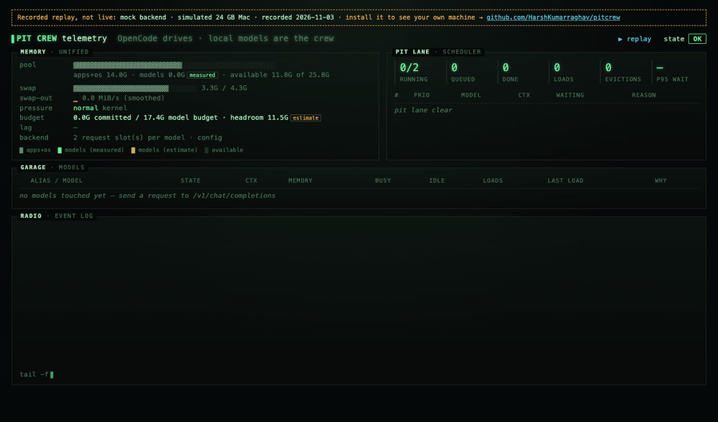
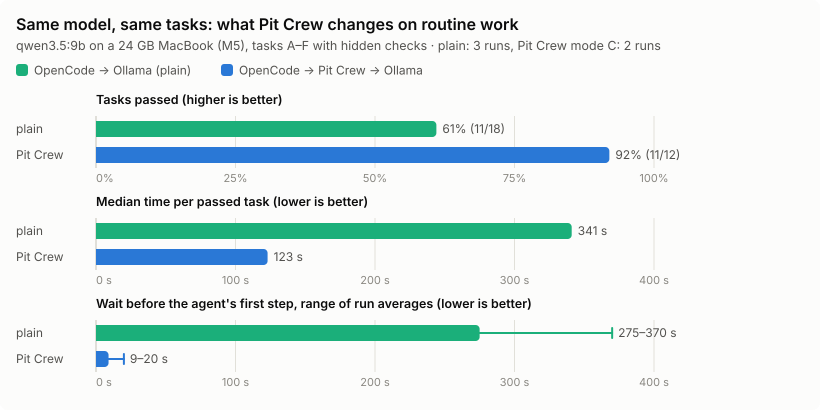
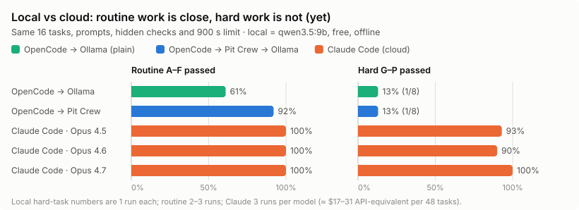
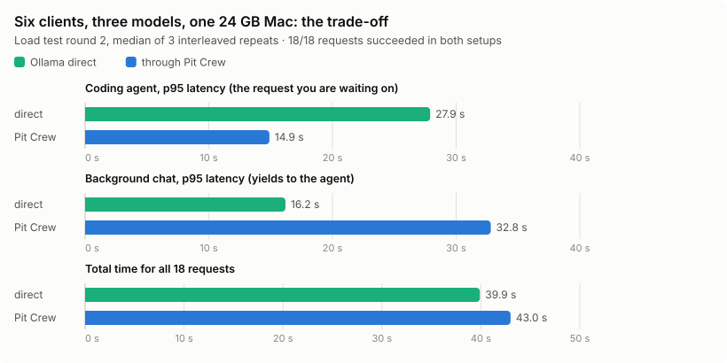
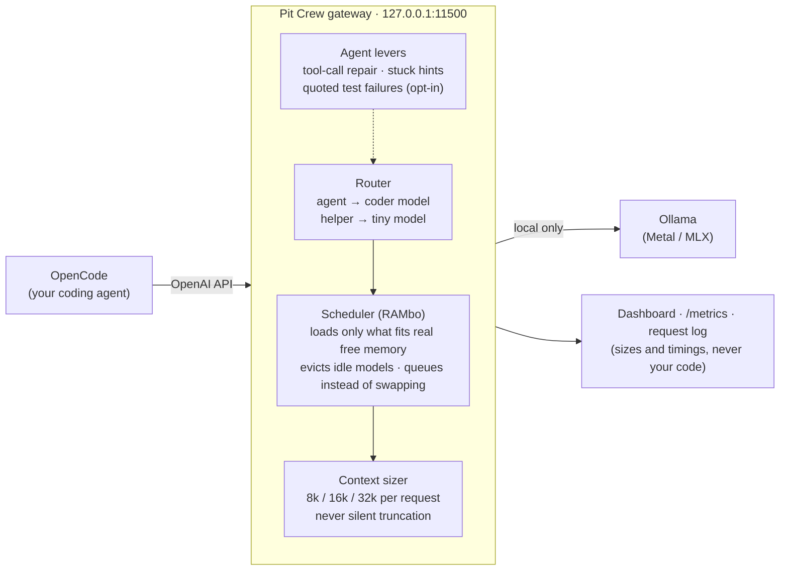
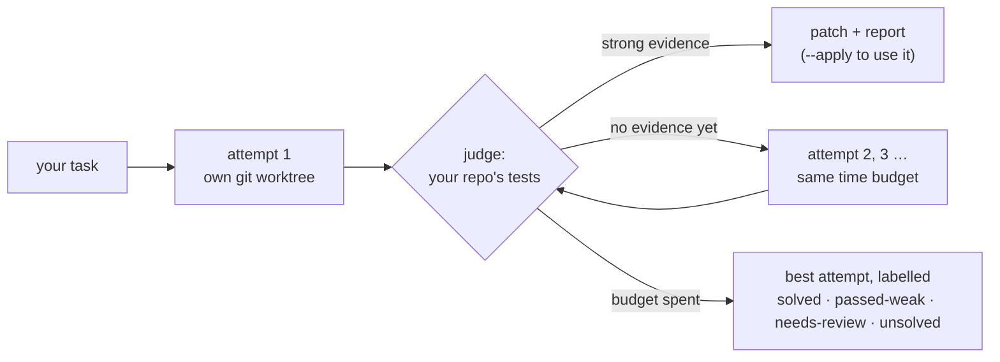

# Pit Crew

**Run several local LLMs on one Mac without swapping.** A memory-aware gateway between
[OpenCode](https://opencode.ai) and [Ollama](https://ollama.com) that makes a free local coding model
noticeably more useful on an ordinary laptop.

[](https://github.com/HarshKumarraghav/pitcrew/actions/workflows/ci.yml)
[](https://www.npmjs.com/package/pitcrew-ai)
[](LICENSE)
[](https://github.com/HarshKumarraghav/pitcrew/discussions)



```sh
npx pitcrew-ai init     # checks your Mac, picks models that fit its memory, sets everything up
```

**[Live demo →](https://harshkumarraghav.github.io/pitcrew/)** the real dashboard replaying a recorded session
(mock backend on a simulated 24 GB Mac; [how it is recorded](scripts/demo/record.mjs)).
Or let your coding agent do it: [one prompt](#let-your-agent-set-it-up).

**OpenCode drives. Your local models are the crew. No swap, no cloud, no crashes.**

---

## Results at a glance

Same model (`qwen3.5:9b`), same laptop (24 GB MacBook Pro, Apple M5, with Chrome, Slack and an editor
open), same 16 coding tasks graded by **hidden tests the agent never sees**. The only difference is
whether OpenCode talks to Ollama directly or through Pit Crew.

| | OpenCode → Ollama | **OpenCode → Pit Crew → Ollama** | change |
|---|---|---|---|
| Routine tasks passed (A–F) | 61% (11/18) | **92% (11/12)** | **+31 points** |
| Median time per passed task | 341 s | **123 s** | **≈ 2.8× faster** |
| Wait before the agent's first step | 275–370 s | **9–20 s** | the 5-minute stall is gone |
| Agent p95 latency, 6 clients on 3 models | 27.9 s | **14.9 s** | **≈ 2× faster** |
| Hard tasks passed (G–P) | 13% (1/8) | 13% (1/8) | **no change** (see [limits](#what-it-does-not-do-yet)) |
| Cost, data leaving the machine | $0, none | $0, none | |

<picture>
  <source media="(prefers-color-scheme: dark)" srcset="docs/img/bench-routine-dark.svg">
  
</picture>

**Why the same model does better:** it isn't smarter. It stops being blocked and starved.

1. **OpenCode's background "title" request no longer blocks the agent.** Without Pit Crew it goes to
   the same thinking model, thinks for up to 5 minutes, and the first real step waits behind it.
   Pit Crew sends it to a tiny model with thinking off: **0.2 s instead of 14 s to 5 min**.
2. **The coding model is never swapped out mid-task.** Pit Crew only loads what fits the memory that
   is *actually* free next to your apps, and evicts idle models first.
3. **The context window is sized per request.** It is never silently truncated or left at a default
   that is too small.
4. **Your agent's requests go first.** Background chat waits instead of competing with the request
   you are watching.

### Compared with a frontier cloud agent

<picture>
  <source media="(prefers-color-scheme: dark)" srcset="docs/img/bench-vs-cloud-dark.svg">
  
</picture>

| setup | runs on | routine A–F | hard G–P | median time per passed task (A–F · G–P) | cost for 3 × 16 tasks |
|---|---|---|---|---|---|
| OpenCode → Ollama, qwen3.5:9b | your laptop | 11/18 (61%) | 1/8 (13%) | 341 s · 89 s | $0 |
| **OpenCode → Pit Crew → qwen3.5:9b** | your laptop | **11/12 (92%)** | 1/8 (13%) | **123 s** · 98–190 s | **$0** |
| Claude Code + Opus 4.5 | cloud | 18/18 (100%) | 28/30 (93%) | 36 s · 64 s | ≈ $17 API-equivalent |
| Claude Code + Opus 4.6 | cloud | 18/18 (100%) | 27/30 (90%) | 31 s · 79 s | ≈ $17 |
| Claude Code + Opus 4.7 | cloud | 18/18 (100%) | 30/30 (100%) | 53 s · 92 s | ≈ $31 |

**Reading it honestly:**
- **On routine work, a free local model with Pit Crew gets close to the cloud** (92% vs 100%). It is
  ~3× slower per task and fully offline.
- **On hard multi-step tasks the 9B model fails ~7 of 8 times, with or without Pit Crew.** Scheduling
  doesn't make a small model smarter. Closing that gap is the [roadmap](#roadmap-the-breakthrough-plan).

### Under load: the trade-off

Six clients at once: two coding agents sending a real 5.9k-token OpenCode request, two chats on a 2B
model, and two title requests on a 0.8B model. All three models share one 24 GB Mac.

<picture>
  <source media="(prefers-color-scheme: dark)" srcset="docs/img/bench-load-dark.svg">
  
</picture>

| metric (median of 3 interleaved repeats) | Ollama direct | through Pit Crew |
|---|---|---|
| Coding agent p95 latency | 27.9 s | **14.9 s** |
| Background chat p95 latency | **16.2 s** | 32.8 s |
| Total time for all 18 requests | **39.9 s** | 43.0 s |
| Memory pushed to swap | 3.32 GB | **0.13 GB** (ranges overlap) |
| Requests that succeeded | 18/18 | 18/18 |

Pit Crew trades a little total throughput (~8%) and background chat speed for **half the wait on the
request you're working on** and much less swapping. That is the point: the agent goes first.

---

## How it is measured

Benchmarks only count if you can check them, so everything is in this repo and reproducible.

| | |
|---|---|
| **Machine** | MacBook Pro, Apple M5 (10-core GPU), 24 GB, macOS 26.3. Real background load: Chrome, Zed, Slack, Spotify; ≈ 13 GB already in swap before any model loaded |
| **Software** | Ollama 0.40.11 (MLX runner), OpenCode 1.18.35, `qwen3.5:9b` (NVFP4) + `qwen3.5:0.8b` helper |
| **Tasks** | 16 tasks on a small TypeScript web app ([`bench/agent/fixture`](bench/agent/fixture)), each in a fresh git copy |
| **Grading** | Hidden verifier tests copied in *after* the agent finishes, plus checks that existing tests were not edited, skipped or deleted ([`bench/agent/lib.mjs`](bench/agent/lib.mjs)) |
| **Limits** | 900 s per task; edits and shell allowed only inside the task's temp folder |
| **Fairness** | Configurations run **interleaved** task by task, so they see the same machine conditions ([`interleave.sh`](bench/agent/interleave.sh)); machine state is logged before every task |
| **Validity** | Runs that overlapped a laptop sleep (checked in the power log) are marked invalid and excluded (46 runs from one overnight session alone) |
| **Self-test** | [`selftest.mjs`](bench/agent/selftest.mjs) proves every task fails on the untouched code and passes with the reference fix |

**The tasks.** A–F are routine; G–P are deliberately hard and stay fixed (never eased to make numbers
look better).

| task | what it tests | task | what it tests |
|---|---|---|---|
| **A** | write a function + its tests | **G** | new endpoint that collides with an existing route |
| **B** | explain the repo (no edits allowed) | **H** | rename a field and change its type across every layer |
| **C** | multi-file feature | **I** | flaky, order-dependent test (shared state) |
| **D** | debug failing tests without touching them | **J** | misleading stack trace |
| **E** | run tools and report exact counts | **K** | config from environment variables + code |
| **F** | multi-step work with a hidden route-order trap | **L** | pagination off-by-one across API, server and client |
| | | **M** | stricter validation without weakening tests |
| | | **N** | performance fix (20,000-row import, hidden timing check) |
| | | **O** | refactor that must keep the public API |
| | | **P** | find a regression in git history, then fix it |

Per-task routine results (passes / runs): plain A 3/3 · B 1/3 · C 1/3 · D 3/3 · E 3/3 · F 0/3;
Pit Crew A 2/2 · B 2/2 · C 2/2 · D 2/2 · E 2/2 · F 1/2.

**Sample sizes are small** (1–3 runs per setup), and the tables label them. Full method, raw numbers and
caveats are in **[docs/BENCHMARKS.md](docs/BENCHMARKS.md)**. Reproduce with:

```sh
node bench/agent/selftest.mjs                                     # tasks are valid
bench/agent/interleave.sh "A B C D E F" "baseline today" 1 1      # plain vs Pit Crew, interleaved
bench/e2e.sh                                                      # 28 end-to-end checks against real Ollama
```

---

## Why Pit Crew exists

Measured on the same 24 GB Mac before Pit Crew:

- Kernel memory pressure was already **warn**, with ~13 GB in swap, *before any model loaded*.
- Loading a 7.6 GB coding model pushed **≈ 5.7 GB of your other apps into swap**.
- During one agent session the model's resident memory **grew from 8 GB to 17 GB**. Load-time size is
  not a safe estimate.
- OpenCode's default prompt with a typical skills folder is **≈ 24k tokens** (≈ 5.9k with the local
  profile), so the context window has to be chosen deliberately.
- OpenCode's session-title request went to the same thinking model, ran for 5 minutes and **blocked
  the first agent step for 5 m 20 s**. In one run, 69% of the total time was spent waiting on it.

Local runtimes size models against the GPU limit, not against what your other apps are using.
Pit Crew fills that gap.

## How it works



| | |
|---|---|
| **Memory-aware scheduling** | Loads a model only if it fits *real* headroom (free + clean cache + part of compressible memory, minus reserves). Evicts idle models LRU-first, never one that is mid-request. Queues instead of thrashing. |
| **Thrash control** | Watches the swap-out *rate* and kernel pressure. Under sustained pressure it drops to one request at a time, sheds idle models and pauses background work. |
| **Context sizing** | Picks the smallest window that fits each request and keeps it sticky to avoid reloads. Returns a clear error instead of truncating. |
| **Router (`auto`)** | Mode A: one model for everything. Mode B: helper requests (titles, short summaries) go to the light model, heavy work runs one at a time. Mode C (default): the light model is used only when it fits without an eviction; otherwise the resident coder is reused. |
| **Tool-call repair** *(opt-in)* | Small models sometimes write a tool call as plain text, and the agent then quits. Pit Crew turns such text back into a real tool call. Off by default until measured. |
| **Agent levers** *(opt-in)* | Reasoning budget per step, repo map in the prompt, plan-first, loop hints, test-repair hints that quote the failing assertion, and "you're stuck" hints. Each is a flag, off by default, and measured separately. |
| **Product intelligence** | `pitcrew scout` writes an overview, architecture, module map, dependency graph, conventions and testing guide from code, manifests and git, stored in `~/.pitcrew`, never in your repo. `pitcrew context "<task>"` returns the files that matter. |
| **Local only** | Binds to 127.0.0.1, refuses `:cloud` models, makes no outbound calls, never logs prompt text. |
| **Observable** | Dashboard at `/`, JSON at `/governor/state`, live SSE, Prometheus `/metrics`. Measured and estimated values are labelled. |
| **Zero runtime dependencies** | Node ≥ 22 standard library only. |

## Quick start

Needs Node ≥ 22.6 and [Ollama](https://ollama.com/download). macOS on Apple Silicon is the main
target; Linux works but is less tested.

```sh
npx pitcrew-ai init      # look at the machine, recommend a coder + light model, ask, then set up
npx pitcrew-ai serve     # gateway + dashboard on http://127.0.0.1:11500
OPENCODE_CONFIG=~/.pitcrew/opencode.json opencode
npx pitcrew-ai doctor    # if anything is off: checks each link and prints the fix
```

`init` reads total and free memory, what Ollama has pulled and whether OpenCode is installed, then
shows a plan like this before changing anything:

```
recommended for a 16 GB machine
  coder   qwen3.5:4b     4.5 GB estimate        not pulled → download
  light   qwen3.5:0.8b   1.2 GB on disk         already pulled ✓
  context 16k for the coder · model budget 11.4 GB · coder + light ≈ 6.1 GB (estimate)

will do
  1. ollama pull qwen3.5:4b
  2. write ~/.pitcrew/config.json
  3. write ~/.pitcrew/opencode.json   (your own OpenCode config is untouched)
```

Picks come from measured data in [docs/MODELS.md](docs/MODELS.md), not from a model. Override with
`--coder <tag>` / `--light <tag>`; `--json` prints the plan for scripts; `--yes` skips the question.

### Let your agent set it up

Paste this into Claude Code, OpenCode, Codex or any agent that can run commands:

```text
Set up Pit Crew (local LLM gateway for OpenCode + Ollama) on this machine by following
https://raw.githubusercontent.com/HarshKumarraghav/pitcrew/main/docs/AGENT_SETUP.md
Explain the plan to me and wait for my OK before downloading models or writing files.
```

It runs `init --json`, explains the recommendation, applies it after you agree, starts the gateway
and runs `doctor`. Steps: [docs/AGENT_SETUP.md](docs/AGENT_SETUP.md).

### Use Claude Code on your local models

Prefer Claude Code's interface? Point it at Pit Crew instead of the cloud:

```sh
npx pitcrew-ai serve          # in one terminal
bin/claude-local              # from a clone of this repo: Claude Code, same flags, on qwen3.5:9b
```

`bin/claude-local` sets everything for that one process only; `~/.claude` and your login are not
changed.
- **Gateway:** it points Claude Code at `127.0.0.1:11500`, Pit Crew's local copy of the Anthropic
  Messages API. Any `claude-*` model name is served by the local router.
- **Context:** it declares the local model's real window (32k), so Claude Code compacts in time
  instead of assuming 200k.
- **Traffic:** it turns off Claude Code's non-essential traffic.

Measured once (n = 1, on battery): Claude Code + Pit Crew + `qwen3.5:9b` passed **task D** in 60 s,
with hidden checks passing. A per-process watcher saw no outside connections. Caveats:
- Anthropic does not support Claude Code on non-Claude models. It works, unsupported.
- The opt-in levers (hints, retrieval) only edit OpenCode-style requests so far. Claude Code
  requests get routing, memory management and context sizing.

`pitcrew agents` lists which coding agents are installed and what Pit Crew can do with each.

### From source

```sh
git clone https://github.com/HarshKumarraghav/pitcrew.git && cd pitcrew
npm install              # dev tools only (typescript); runtime has no dependencies
npm run dev -- init
npm run dev -- serve
```

`bin/opencode-local` launches OpenCode with the local-only profile and turns off OpenCode's update
checks, model-metadata fetches and LSP downloads. Set `PITCREW_OPENCODE_PROFILE` to choose the
profile it uses.

## Commands

| command | |
|---|---|
| `pitcrew init` | recommend models for this machine, pull them, write config + OpenCode profile |
| `pitcrew doctor` | check Ollama, models, memory, gateway and OpenCode; print fixes |
| `pitcrew serve` | gateway, router, scheduler, dashboard |
| `pitcrew solve "<task>"` *(experimental)* | best-of-N attempts in throwaway git worktrees, judged by your repo's own tests; `--apply` writes a passing attempt to your checkout |
| `pitcrew agents` | coding agents installed here (Claude Code, OpenCode, Codex…), logged in or not, and how Pit Crew can use each |
| `pitcrew audit` | machine, memory, swap, pressure, runtimes, local and cloud models |
| `pitcrew garage` | each local model's estimated / calibrated / measured memory and whether it fits now |
| `pitcrew scout <repo>` | analyse a repository (deterministic) |
| `pitcrew context "<task>" --repo <dir>` | most relevant files with reasons |
| `pitcrew status` | live scheduler state |
| `pitcrew clean --yes` | remove Pit Crew's derived context models (`pitcrew/*`, metadata only) |

### `pitcrew solve` (experimental)



Small models fail mostly by guessing once and stopping, so `solve` gives them several independent
tries and lets **your own tests** pick the winner. "Tests pass" alone is not enough evidence: in our
hard tasks, the existing suite already passed before any change in 8 of 10 cases. An attempt
therefore counts only if:

- the suite failed before and passes now, or
- it adds a test that **fails on the original code and passes with the change**.

Attempts that delete, skip or edit existing tests are never applied. Your checkout is untouched unless
you pass `--apply`.

Options:
- `--agent claude`: Claude Code makes the local attempts instead of OpenCode.
- `--escalate pitcrew/big`: one last attempt with a 27B model in exclusive mode.
- `--helper claude` *(off by default)*: if nothing local produced evidence, **your own** Claude Code
  login gets the task, the failing tests and the best local diff. It is capped per day
  (`helper.maxPerDay`). With no helper set, `solve` makes no cloud calls. Results so far: it works end to end (task D solved on the first attempt, hidden
checks pass), but the best-of-3 benchmark has **not been run yet**.

## What it does not do (yet)

- **It doesn't make a small model smart.** Hard multi-step tasks stay at ~13% for `qwen3.5:9b`, with
  or without Pit Crew.
- **It's not the fastest path to raw throughput.** Under load the total time is ~8% longer, because
  the agent's requests go first.
- **Samples are small.** 1–3 runs per configuration on one machine. Treat differences of one task as
  noise.
- **It's tested mainly on Apple Silicon.** Linux memory probing is implemented but less tested.

## Roadmap: the breakthrough plan

Targets were fixed before measuring, and results get published whether or not we hit them
([docs/BREAKTHROUGH_PLAN.md](docs/BREAKTHROUGH_PLAN.md)):

| # | goal | today | target |
|---|---|---|---|
| T1 | local-only hard tasks (G–P, not eased) | 13% | **≥ 40%** |
| T2 | local-only routine tasks (A–F) | 92%, ~2 min/task | **≥ 95%, ≤ 90 s/task** |
| T3 | with *your own* cloud agent as an optional helper | — | **≥ 95% of its solo success at ≤ 30% of its usage** |
| T4 | public benchmark (Aider polyglot subset) | — | published score, local-only and with a helper |
| T5 | other machines | 24 GB | 8 / 16 / 24 / 32 GB reports, never "critical" pressure |
| T6 | 8 GB laptops | — | routine ≥ 60% local-only, fully automatic setup |

| phase | what | status |
|---|---|---|
| 0 | tool-call repair; fix the OpenCode end-to-end check | built, e2e 27/28; repair ablation pending |
| 1 | stuck signals, quoted test failures, `pitcrew solve` (best-of-N) | built and tested; G–P ablations pending |
| 2 | "exclusive mode" + a bigger local model (27B) only for hard tasks | built and tested; 27B smoke test and cascade ablation pending |
| 3 | any agent as front-end (Claude Code, Codex) and optional cloud helper | Claude Code front-end + helper built and checked once (task D, local); Codex not installed here, untested |
| 4 | 8 GB laptops | planned |
| 5–6 | public benchmark runs, release | planned |

## Choosing models

See [docs/MODELS.md](docs/MODELS.md). Short version for 24 GB machines: Qwen3.5-9B is the largest
current Qwen that fits beside a normal desktop workload. 27B-class models (Qwen3.6/3.8-27B, 17–18 GB
at 4-bit) and 30B MoE models (19–22 GB) do not, even though their benchmark scores are higher. On
32 GB+ machines, try Qwen3.8-27B.

## Status

Early (0.1). Tested on macOS 26 / Apple M5 / Ollama 0.40 / OpenCode 1.18. See
[docs/PLAN.md](docs/PLAN.md) for the detailed log and [docs/ARCHITECTURE.md](docs/ARCHITECTURE.md)
for internals.

## Contributing

Issues, hardware reports and pull requests are welcome. **Benchmark results from other machines are
especially useful** ([hardware report template](https://github.com/HarshKumarraghav/pitcrew/issues/new?template=hardware-report.yml)). See [CONTRIBUTING.md](CONTRIBUTING.md), the
[good first issues](https://github.com/HarshKumarraghav/pitcrew/labels/good%20first%20issue) and
[Discussions](https://github.com/HarshKumarraghav/pitcrew/discussions). Security reports:
[SECURITY.md](SECURITY.md).

## License

MIT. Model weights are not included; each model has its own license (Qwen3.5: Apache 2.0).
